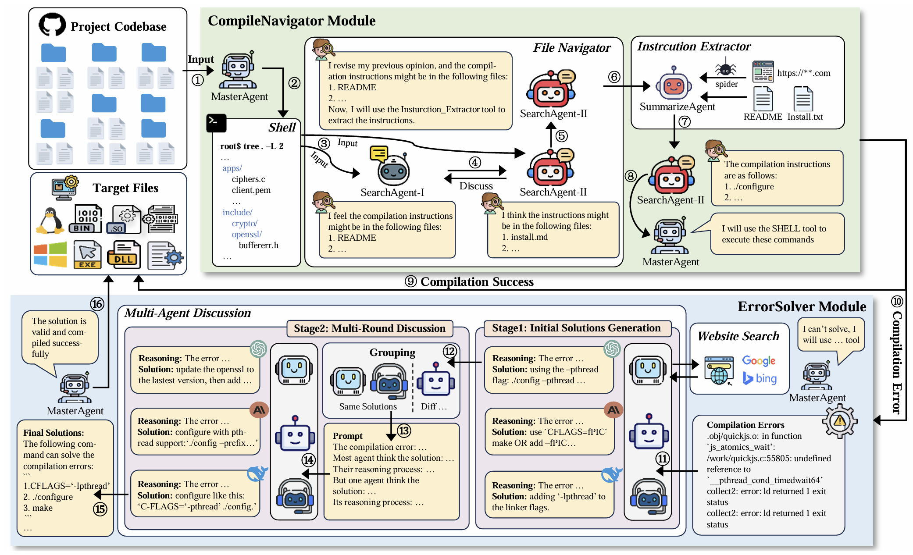

# NT521 CompileAgent (Local LLM Edition)

Hệ thống tự động biên dịch mã nguồn C/C++ cấp repository từ GitHub bằng kiến trúc Multi-Agent trong Docker, triển khai bám sát mã nguồn gốc [Ch3nYe/AutoCompiler](https://github.com/Ch3nYe/AutoCompiler) (bài báo ACL 2025 *CompileAgent*) và cấu hình vận hành **100% bằng Local LLMs** (không sử dụng Cloud API Key).

## Kiến trúc hệ thống



Với mỗi repository trong file cấu hình JSON, hệ thống thực hiện theo luồng **Flow-based Agent Strategy** và 2 module chính của `AutoCompiler`:

1. **`MasterAgent` (`scripts/compile.py`, `src/compile_agent/agent/executor.py`, `src/compile_agent/config.py`)**:
   - Điều phối clone mã nguồn (`git clone --depth 1` trong `src/compile_agent/infra/downloader.py`), tạo bản sao làm việc riêng cho từng project và mở phiên tương tác SSH trong Docker container (`autocompiler:gcc13`).
   - Vận hành vòng lặp ReAct (`max_iterations=30`, `max_execution_time=1800` mặc định, điều chỉnh qua `AGENT_MAX_EXECUTION_TIME`) kết nối 3 công cụ: `Shell`, `CompileNavigator`, và `ErrorSolver`.
   - Hỗ trợ Local Reasoning LLMs thông qua `ReasoningSafeChatOpenAI`, `SafeReActSingleInputOutputParser`, nén ngữ cảnh scratchpad (`_compact_observation`) và cơ chế chống lặp lệnh (`State-Epoch Repetition Guard`).

2. **Môi trường thực thi `Shell` & Compiler Wrapper (`src/compile_agent/infra/docker_tools.py`, `docker/`)**:
   - Container Docker xây dựng từ `docker/Dockerfile` trên nền `gcc:13.2.0` (`autocompiler:gcc13`), giao tiếp qua `InteractiveDockerShell` (SSH PTY persistent session giữ nguyên thư mục hiện tại và biến môi trường giữa các lệnh).
   - Tích hợp `docker/wrappers/wrapper_compiler.sh` và `docker/wrappers/wrapper_strip.sh` để bọc các trình biên dịch (`gcc`, `g++`, `clang`, `clang++`, ...) cùng `strip`, hỗ trợ chèn cờ biên dịch qua `WRAPPER_OPTI` và tự động gom các file thực thi/thư viện sinh ra về `/log/`.

3. **`CompileNavigator` (`src/compile_agent/agent/navigator.py`)**:
   - Sub-agent chuyên tìm kiếm và trích xuất hướng dẫn biên dịch cho `MasterAgent` thông qua 3 công cụ con: `DEBATE` (2 agent thảo luận chọn file tài liệu từ cấu trúc thư mục), `SEARCH_INSTRUCTIONS_FROM_FILES` (đọc file tài liệu), và `GET_CONTENT_FROM_URL` (cào nội dung trang hướng dẫn bên ngoài).

4. **`ErrorSolver` (`src/compile_agent/agent/error_solver.py`, `src/compile_agent/agent/web_search.py`)**:
   - Triển khai thuật toán **Multi-Agent Discussion 3 tác tử qua 2 vòng** (Phase 1: Round 0 Initial Response + Phase 2: Round 1 Debate) kết hợp **Weighted Confidence Voting** (`trans_confidence`, `count_common_words` với `threshold=30`) và công cụ tìm kiếm web `Search_Agent`.
   - Khi cấu hình 1 model local, 3 tác tử chạy ở 3 mức nhiệt độ (`temperature = [0.1, 0.4, 0.7]`) để tạo đa dạng lập luận; hoặc có thể chỉ định danh sách model khác nhau qua `DISCUSSION_MODELS`.

5. **Kiểm định artifact & Tổng hợp (`src/compile_agent/reporting/logs.py`, `scripts/evaluate.py`)**:
   - Quét artifact ELF (`\x7fELF`) và static archive (`!<arch>\n`) do build tạo ra, lọc bỏ file tạm/probe của CMake & Autoconf, đối chiếu danh sách `files` mục tiêu theo hai mức Non-Strict và Strict (`is_compiled`), chạy kiểm tra `file`/`ldd` (`smoke_check_artifact`), và ghi log `.txt`, `.json`, `results.jsonl`, `statistics.csv`.

## Cấu trúc thư mục

```text
NT521_CompileAgent/
├── README.md
├── requirements.txt
├── .env.example
├── .gitignore
├── .dockerignore
├── src/
│   └── compile_agent/
│       ├── __init__.py
│       ├── config.py                  # Cấu hình Local LLM, Circuit Breaker, prompt templates
│       ├── agent/
│       │   ├── __init__.py
│       │   ├── executor.py            # ReAct parser/executor cho Local LLM, chống lặp lệnh
│       │   ├── navigator.py           # CompileNavigator tìm & trích xuất hướng dẫn build
│       │   ├── error_solver.py        # ErrorSolver (3-agent 2-round Debate & Weighted Voting)
│       │   └── web_search.py          # Search_Agent tra cứu lỗi biên dịch trên web
│       ├── infra/
│       │   ├── __init__.py
│       │   ├── docker_tools.py        # InteractiveDockerShell (SSH PTY) và RAG đọc tài liệu
│       │   └── downloader.py          # Clone repo (git clone --depth 1) và chuẩn hóa LF
│       └── reporting/
│           ├── __init__.py
│           └── logs.py                # Kiểm định artifact ELF (is_compiled), smoke check, ghi log
├── scripts/
│   ├── compile.py                     # Script chạy biên dịch chính và thực nghiệm Ablation
│   ├── evaluate.py                    # Tổng hợp log chạy & so sánh Ablation ra CSV / Markdown / JSON
│   └── check_env.py                   # Kiểm tra Python, Docker daemon, image và Local LLM server
├── docker/
│   ├── Dockerfile                     # Định nghĩa image autocompiler:gcc13 (GCC 13.2.0)
│   └── wrappers/
│       ├── wrapper_compiler.sh        # Compiler wrapper (chỉnh cờ biên dịch qua WRAPPER_OPTI)
│       └── wrapper_strip.sh           # Strip wrapper giữ lại debug symbols
├── configs/
│   ├── projects_benchmark.json        # Tập 12 repo dùng test nhanh
│   └── projects.json                  # Bộ benchmark đầy đủ 100 repo C/C++ (CompileAgentBench)
├── tests/
│   └── test_stability_regression.py   # Bộ unit test kiểm thử hồi quy
├── docs/
│   └── images/
│       └── workflow.png               # Sơ đồ kiến trúc hệ thống
├── dataset/                           # Mã nguồn clone về và bản copy build tạm (gitignore bỏ qua)
└── outputs/                           # Thư mục lưu log chạy thực nghiệm và báo cáo (được track trên Git)
```

## Yêu cầu hệ thống

- Windows 10/11 64-bit (hoặc Linux).
- Git.
- Python 3.9 – 3.12.
- Docker Desktop (chạy ở chế độ Linux containers).
- Server **Local LLM** tương thích OpenAI API (`llama.cpp` / `llama-server`, `Ollama`, `vLLM`, hoặc `LM Studio`) — **không cần API key**.

## Cài đặt môi trường

### Bước 1: Tạo môi trường ảo và cài thư viện Python

```powershell
python -m venv .venv
.venv\Scripts\activate
python -m pip install --upgrade pip
pip install -r requirements.txt
```

Nếu chỉ muốn cài các gói lõi phục vụ chạy thực nghiệm (không cài các gói tùy chọn như `chromadb`):

```powershell
pip install python-dotenv openai langchain langchain-openai langchain-community langchain-core paramiko docker click beautifulsoup4 tenacity duckduckgo-search googlesearch-python requests chardet pandas tqdm fake-useragent
```

### Bước 2: Build Docker image

Đảm bảo Docker Desktop đang chạy, sau đó build image `autocompiler:gcc13`:

```powershell
docker build -f docker/Dockerfile -t autocompiler:gcc13 .
```

### Bước 3: Cấu hình Local LLM trong `.env`

Tạo file `.env` từ `.env.example` (`.env` bị `.gitignore` bỏ qua, không commit lên Git):

```powershell
copy .env.example .env
```

Mặc định `.env.example` cấu hình sẵn cho **`llama.cpp` (`llama-server` với Vulkan SDK)** tại `http://localhost:8080/v1`:

```env
LLM_PROVIDER=llamacpp
LLM_BASE_URL=http://localhost:8080/v1
MASTER_MODEL=Qwen 3.8 K_M Q4 27B
DISCUSSION_MODELS=Qwen 3.8 K_M Q4 27B
LLM_CONTEXT_WINDOW=16384
LLM_THINKING=false
```

Khởi chạy `llama-server` với Vulkan SDK (`-ngl 99` đẩy các layer lên GPU, `--jinja --reasoning off -c 16384` tắt thinking từ server để tránh cắt cụt chuỗi ReAct):

```powershell
llama-server -m <path_to_qwen3.8_27b_q4_k_m.gguf> -ngl 99 --port 8080 --jinja --reasoning off -c 16384
```

Nếu dùng **Ollama**, **vLLM** hoặc **LM Studio**, bỏ comment block tương ứng trong `.env.example` để đổi `LLM_PROVIDER`, `LLM_BASE_URL`, `MASTER_MODEL`, `DISCUSSION_MODELS`.

### Bước 4: Kiểm tra môi trường

```powershell
python scripts/check_env.py
```

Script sẽ kiểm tra lần lượt:
1. Phiên bản Python và các package bắt buộc/tùy chọn.
2. Trạng thái Docker daemon (`docker info`, `docker ps`) và image `autocompiler:gcc13`.
3. Kết nối tới `LLM_BASE_URL`, danh sách `/models`, phản hồi `/chat/completions` của `MASTER_MODEL` & `DISCUSSION_MODELS` (và `/embeddings` nếu có cấu hình `OPENAI_EMBEDDING_MODEL`).

## Tham chiếu các cờ dòng lệnh (CLI Options)

### 1. `scripts/compile.py`

| Cờ / Tham số | Kiểu / Mặc định | Ý nghĩa thực tế trong `scripts/compile.py` |
| :--- | :--- | :--- |
| `-j`, `--json_path` | `str` *(bắt buộc)* | Đường dẫn file JSON danh sách repo cần biên dịch (`configs/projects.json` hoặc `configs/projects_benchmark.json`). |
| `-p`, `--dataset_base_path` | `str` *(bắt buộc)* | Thư mục chứa mã nguồn repo clone về và bản sao tạm khi build (ví dụ: `dataset`). |
| `-l`, `--log_path` | `str` *(bắt buộc)* | Thư mục lưu log từng repo (`*.log.*.json`, `*.log.*.txt`, `results.jsonl`, `statistics.csv`). |
| `-c`, `--clean_copied_project` | `bool` *(bắt buộc)* | Có xóa thư mục bản sao tạm sau khi compile xong mỗi repo hay không (`True` khi chạy batch để tiết kiệm ổ cứng, `False` khi cần giữ lại để debug). |
| `-r`, `--retry` | `int` (mặc định `0`) | Số lần chạy lại ngay trong phiên nếu `checker_result` trả về `False`. |
| `-s`, `--strict_checker` | `bool` (mặc định `False`) | `True`: bắt buộc khớp **tất cả** file mục tiêu trong `files`; `False`: chỉ cần khớp **ít nhất 1** file mục tiêu (Non-Strict, chuẩn đánh giá trong bài báo). |
| `--download_proxy` | `str` (mặc định `None`) | Truyền `--config http.proxy=...` cho `git clone` nếu cần proxy tải repo (ví dụ `socks5://127.0.0.1:29999`). |
| `--multi_process` | `bool` (mặc định `False`) | Bật chế độ chạy song song nhiều process cho các repo trong danh sách. |
| `--max-workers` | `int` (mặc định `2`) | Số worker tối đa khi `--multi_process True`. *(Với Local LLM 1 GPU nên để `False` để tránh tranh chấp VRAM/queue).* |
| `--disable-navigator` | flag (mặc định `False`) | Tắt tool `CompileNavigator` (dùng cho thực nghiệm Ablation Study). |
| `--disable-error-solver` | flag (mặc định `False`) | Tắt tool `ErrorSolver` (dùng cho thực nghiệm Ablation Study). |
| `--skip-existing` | flag (mặc định `False`) | Bỏ qua các repo đã có log hợp lệ trong `--log_path` (dùng để chạy nối tiếp sau khi tạm dừng). |
| `--retry-uncertain` | flag (mặc định `False`) | Khi đi kèm `--skip-existing`, giữ nguyên các repo đã PASS và **chỉ chạy lại** những repo trước đó kết thúc ở trạng thái `UNCERTAIN` hoặc dừng sớm do lặp lệnh. |
| `--start-index` | `int` (mặc định `1`) | Chỉ số bắt đầu (tính từ 1) trong danh sách JSON, áp dụng trước `--limit`. |
| `--limit` | `int` (mặc định `0`) | Số lượng repo tối đa sẽ chạy từ `--start-index` (`0` = chạy hết). |
| `--projects-filter` | `str` (mặc định `""`) | Danh sách tên repo phân cách bằng dấu phẩy để chạy chọn lọc (ví dụ: `tiny-AES-c,zlib`). |

### 2. `scripts/evaluate.py`

| Cờ / Tham số | Mặc định | Ý nghĩa thực tế trong `scripts/evaluate.py` |
| :--- | :--- | :--- |
| `--full-dir` | `outputs/runs/benchmark_full` | Thư mục chứa log chạy cấu hình Full `CompileAgent`. |
| `--ablation-dir` | `outputs/runs/benchmark_ablation` | Thư mục chứa log chạy cấu hình Ablation để đối chiếu cặp từng repo (truyền `--ablation-dir=""` nếu chỉ muốn tổng hợp riêng `--full-dir`). |
| `--out-dir` | `outputs/reports/eval` | Thư mục xuất báo cáo gồm `benchmark_report.md`, `benchmark_details.csv`, `benchmark_results.json` (và `ablation_comparison.csv` nếu có `--ablation-dir`). |

## Hướng dẫn chạy biên dịch & đánh giá

### 1. Chạy thử nhanh 1–2 repo

Kiểm tra luồng clone, Docker SSH, `MasterAgent`, `CompileNavigator` và `ErrorSolver` hoạt động trơn tru trên máy:

```powershell
python scripts/compile.py -j configs/projects_benchmark.json -p dataset -l outputs/runs/test_run -c True --projects-filter tiny-AES-c,zlib
```

### 2. Chạy bộ test nhanh 12 repo (`configs/projects_benchmark.json`)

```powershell
python scripts/compile.py -j configs/projects_benchmark.json -p dataset -l outputs/runs/benchmark_12 -c True --skip-existing
```

### 3. Thực nghiệm chính (100 repo — `configs/projects.json`)

Chạy **Full `CompileAgent`** (bật đầy đủ `Shell`, `CompileNavigator`, `ErrorSolver`) trên toàn bộ 100 repo trong `configs/projects.json`:

```powershell
python scripts/compile.py -j configs/projects.json -p dataset -l outputs/runs/benchmark_100 -c True --skip-existing --retry-uncertain
```

- Cờ `--skip-existing` cho phép bấm `Ctrl+C` tạm dừng bất kỳ lúc nào và chạy lại đúng lệnh trên để tiếp tục từ repo kế tiếp.
- Cờ `--retry-uncertain` giữ lại các repo đã pass ở lần trước và tự động chạy lại các repo từng bị dừng ở trạng thái `UNCERTAIN` / loop early-stop.

### 4. Thực nghiệm Ablation Study trên 100 repo (`configs/projects.json`)

Để đánh giá riêng đóng góp của từng module đúng theo thiết kế Ablation trong bài báo (`--disable-error-solver` và `--disable-navigator`), chạy tách từng cấu hình vào thư mục log riêng:

**4A. Tắt `ErrorSolver` trên 100 repo:**

```powershell
python scripts/compile.py -j configs/projects.json -p dataset -l outputs/runs/ablation_no_solver_100 -c True --skip-existing --disable-error-solver
```

**4B. Tắt `CompileNavigator` trên 100 repo:**

```powershell
python scripts/compile.py -j configs/projects.json -p dataset -l outputs/runs/ablation_no_nav_100 -c True --skip-existing --disable-navigator
```

*(Tùy chọn) Tắt đồng thời cả `CompileNavigator` và `ErrorSolver` (chỉ giữ lại `MasterAgent` + `Shell`):*

```powershell
python scripts/compile.py -j configs/projects.json -p dataset -l outputs/runs/ablation_shell_only_100 -c True --skip-existing --disable-navigator --disable-error-solver
```

**Mẹo chia đoạn theo lát cắt hoặc chạy trên nhiều máy:** Dùng `--start-index` và `--limit`, sau đó gộp các file `*.log.*.json` về cùng thư mục `--log_path`:

```powershell
# Ví dụ chạy từ repo thứ 1 đến repo thứ 50:
python scripts/compile.py -j configs/projects.json -p dataset -l outputs/runs/benchmark_100 -c True --skip-existing --start-index 1 --limit 50

# Ví dụ chạy từ repo thứ 51 đến repo thứ 100:
python scripts/compile.py -j configs/projects.json -p dataset -l outputs/runs/benchmark_100 -c True --skip-existing --start-index 51 --limit 50
```

### 5. Tổng hợp và đối chiếu kết quả (`scripts/evaluate.py`)

Tổng hợp riêng kết quả Full 100 repo (lưu ý trên PowerShell dùng `--ablation-dir=""` khi không đối chiếu):

```powershell
python scripts/evaluate.py --full-dir outputs/runs/benchmark_100 --ablation-dir="" --out-dir outputs/reports/eval_100
```

Đối chiếu `Full CompileAgent` (100 repo) với từng lượt Ablation Study (100 repo):

```powershell
# Đối chiếu Full vs Tắt ErrorSolver:
python scripts/evaluate.py --full-dir outputs/runs/benchmark_100 --ablation-dir outputs/runs/ablation_no_solver_100 --out-dir outputs/reports/eval_ablation_no_solver_100

# Đối chiếu Full vs Tắt CompileNavigator:
python scripts/evaluate.py --full-dir outputs/runs/benchmark_100 --ablation-dir outputs/runs/ablation_no_nav_100 --out-dir outputs/reports/eval_ablation_no_nav_100
```

## Kiểm thử hồi quy (Unit Tests)

```powershell
python -m unittest discover -s tests -v
```

## Tham khảo

- Bài báo ACL 2025: [CompileAgent: Automated Real-World Repo-Level Compilation with Tool-Integrated LLM-based Agent System](https://aclanthology.org/2025.acl-long.103/)
- Repository gốc: [Ch3nYe/AutoCompiler](https://github.com/Ch3nYe/AutoCompiler)
